# Website diagrams

This directory holds the website-owned Archify sources, SVG figures, interactive HTML viewers and their receipts. The manifest records what each diagram answers and when to review it. Harness diagrams are vendored separately into the site assets.

Regenerate a site diagram with `bun run --cwd apps/site diagrams:build -- --svg <slug>`. See [the diagram pipeline](../guides/developer/diagrams.md) for vendoring, embedding and verification.

## Command groups

What are the eighteen `ki` command groups, and what does each operate on? The figure follows `man/ki.1` in `tools-ki` at `v0.13.0`; each node cites its manual heading.

[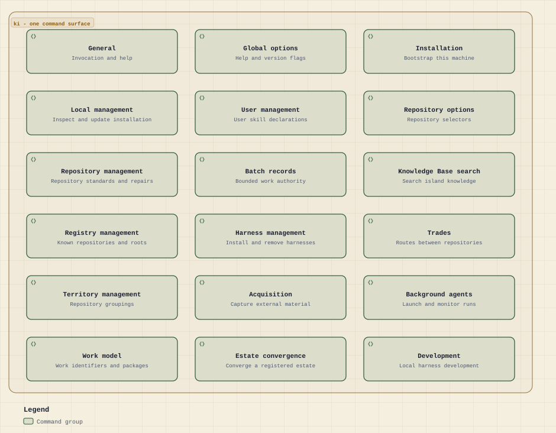](command-groups.html)

## Agent environment

How do portable MCP inventory and context policy reach Claude and Codex? The figure shows intended configuration and bounded repository evidence, not live-session health. It follows the binding and tokenomics skills at harness `8897008f`.

[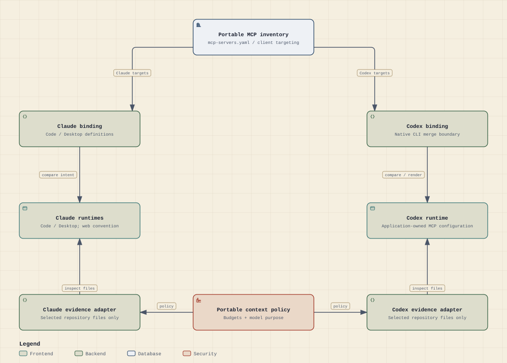](agent-environment.html)

## Work model

Who holds a piece of work, where does it live, and what are the two moves that pass it between supervisor and worker? The figure follows the Work Process note in `ki-principal` at `c070f022`; each node cites the note's lines.

[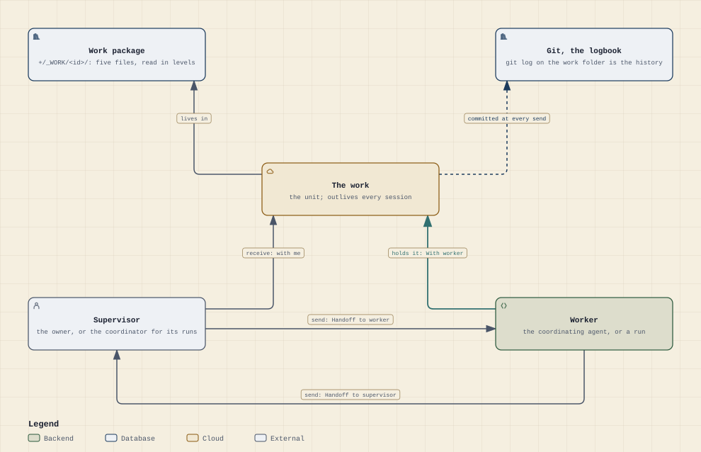](work-model.html)

## Seven states

What are the seven states a piece of work can be in, and which move takes it from one to the next? The figure uses the Work Process note's own state names and receive words, at `c070f022`.

[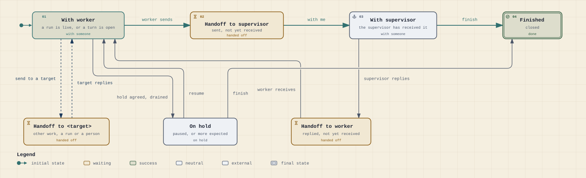](seven-states.html)

## Work folder

What does a work folder hold, how long does each file stay, and who may write into it? The figure follows the work-package standard at harness `8897008f`: the closed list inside the folder, and the entry points outside it.

[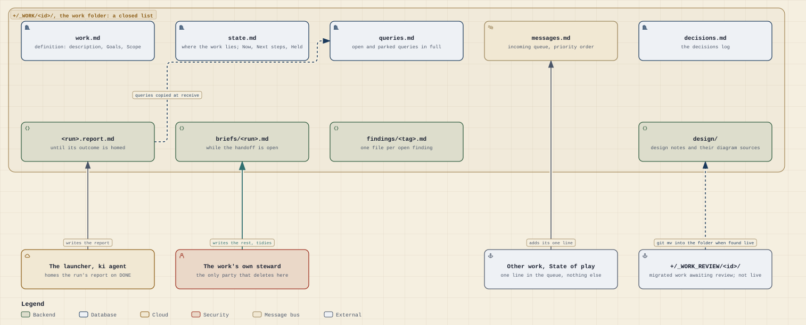](work-folder.html)

## Coordinating turn

What happens in one coordinating turn, from an owner message through launch, wake and receive to the owner report? The figure follows the coordination standard at harness `8897008f`.

[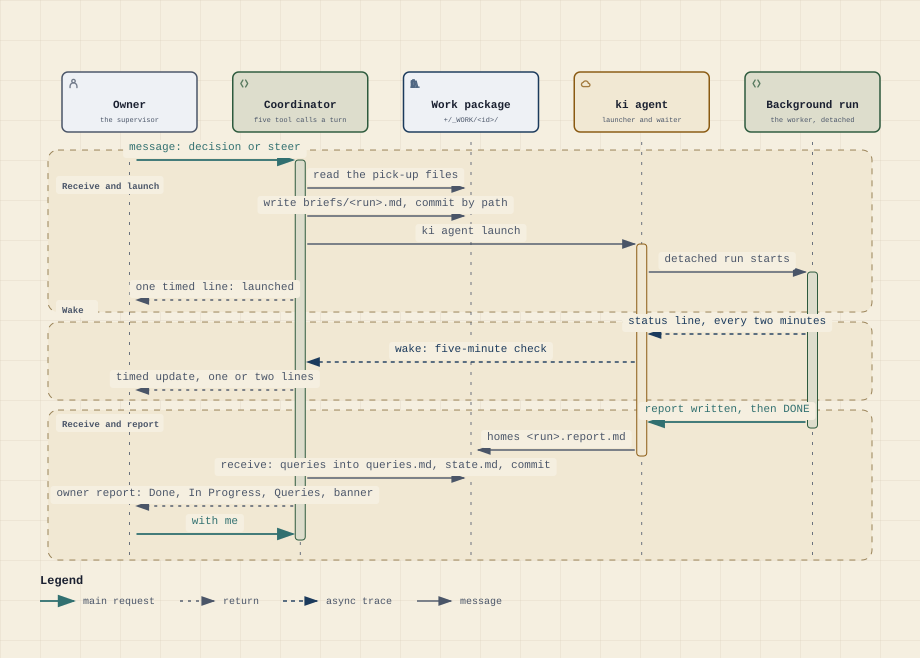](coordinating-turn.html)

## Background run

How does a background run travel from brief to prune, and which file carries each step? The figure follows the background-run standard at harness `8897008f`.

[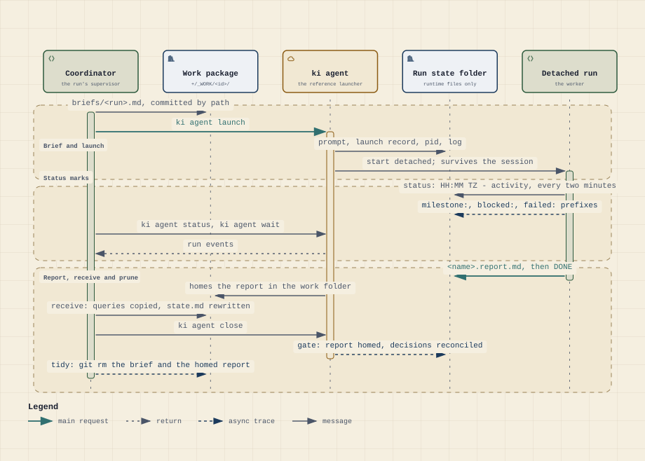](background-run.html)

## Record lifecycle

Which statuses does a work record pass through from capture to pruning, and which skill owns each move? The figure follows the repository roadmaps standard at harness `8897008f`.

[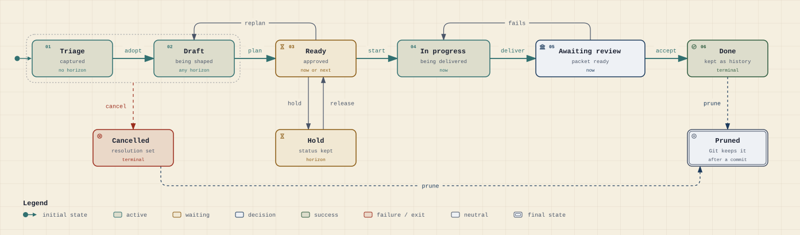](record-lifecycle.html)

## Work design loop

How does an undecided proposal become owner decisions and a piloted rollout? The workflow follows the work-design standard at harness `8897008f`.

[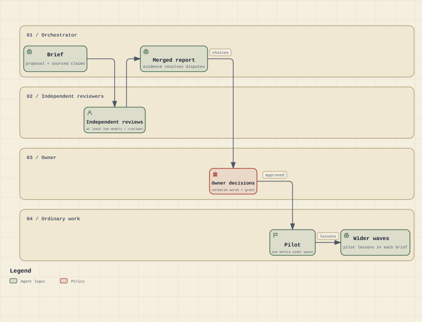](work-design-loop.html)

## Trade

How do local trade copies reach receipt, receiver disposition and eligible release without transferring ownership? The sequence follows the trade standard at harness `8897008f`.

[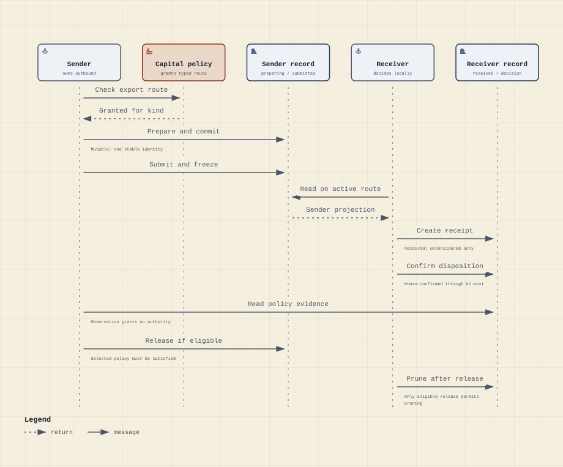](trade.html)

## Recurring occurrence

How is a recurring obligation adopted, scheduled, run, evidenced and reviewed? The workflow follows the recurring-work and Activity standards at harness `8897008f`.

[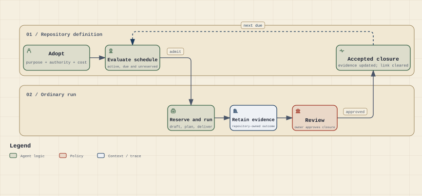](recurring-occurrence.html)

## A finding from the owner's request to its home

What happens to a finding between the owner asking for it and its settled home? The lifecycle shows the finding opened by the request, carried in full through every report, refreshed when its facts change, settled at a mark or on the owner's word, and then homed in a record, a design note or the decisions log, or dropped.

[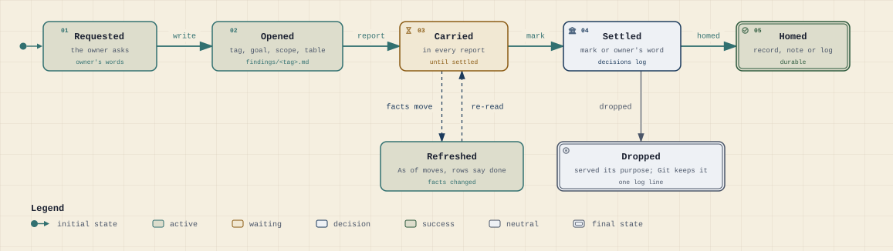](finding-life.html)

## Tending: the structural track and the PMO track

What do the four structural levels and the five PMO levels of a tending pass each look at, and how do captures move between them? The architecture shows the two tracks side by side, the upward movement of captures from level to level, and the owner at the end, who decides every query.

[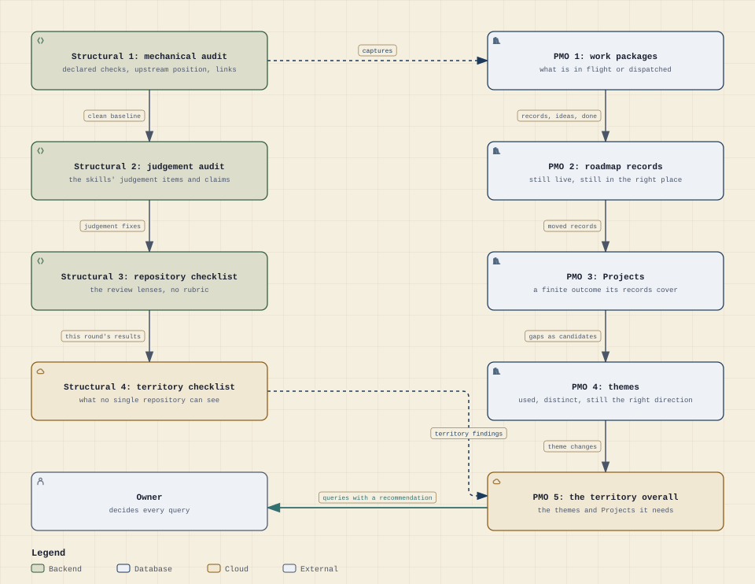](tending-tracks.html)

## One tending pass: focus, pass, dispositions, report

How does one tending pass run, from the owner asking for it to the light report it ends with? The workflow shows the coordinator launching one run per repository for the lower levels, each item given exactly one disposition, the territory levels run from that round's results, and the report that is as light as its outcome allows.

[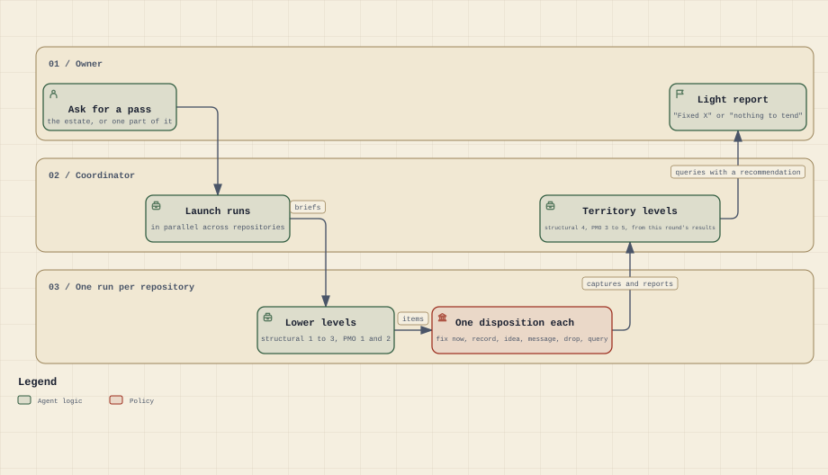](tending-pass.html)
